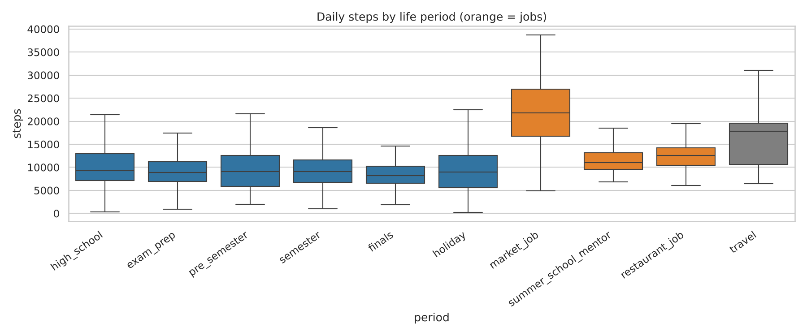
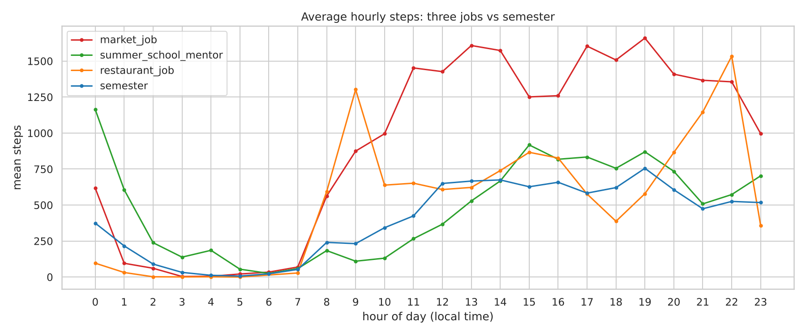
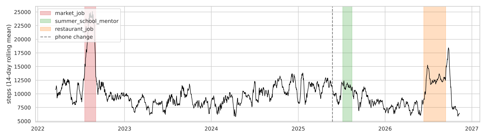

# Three Jobs, One Phone: What My iPhone Knows About How Work Changes My Days

DSA 210 (Introduction to Data Science) term project – Sabancı University, Fall 2026

## Motivation

My iPhone has recorded every step I have taken since March 2022. During that time I finished
high school, spent a year preparing for the university entrance exam, started at Sabancı University
(English preparatory year in 2023-24), and did three different summer jobs:

- **Summer 2022:** supermarket job in Turkey
- **Summer 2025:** mentor at the Sabancı University High School Summer School (three two-week
  residential sessions on campus)
- **Summer 2026:** line cook at a restaurant in Corolla, North Carolina (USA), on a J-1 work visa

This project uses my own Apple Health data to ask a simple question: **how does a physical
job change the shape of my day compared with student life, and do very different jobs
change it in the same way?**

## Data

| | |
|---|---|
| Source | My personal Apple Health export (iPhone) |
| Period | 10 March 2022 – 17 November 2026 |
| Size | 1,714 consecutive days, no missing days |
| Daily variables | steps, walking/running distance, flights climbed, walking speed, step length, headphone audio level, first/last active hour, night (00–05) and evening (17–24) steps |
| Hourly variables | steps per hour |

The raw export is **not** published (it contains health records unrelated to this project).
Only the aggregated daily and hourly tables in `data/` are shared.

### Life periods

Every day has exactly one `period` label, plus a coarser `period_group` (`school`, `break`,
`work`, `travel`). Semester dates come from Sabancı University's official
[academic calendar](https://www.sabanciuniv.edu/en/academic-calendar); high-school and exam
dates come from the MEB and ÖSYM calendars.

| Period | Group | What it means | Days |
|---|---|---|---|
| `high_school` | school | Last months of 12th grade, until YKS 2022 (10 Mar – 19 Jun 2022) | 97 |
| `exam_prep` | school | Studying for YKS 2023 at a library after graduating (3 Sep 2022 – 18 Jun 2023) | 289 |
| `pre_semester` | break | The 7 days before the first class of each semester (move-in, orientation, enrolment) | 42 |
| `semester` | school | First day of classes – last day of classes | 634 |
| `finals` | school | Day after the last class – last final / make-up exam | 82 |
| `holiday` | break | Semester breaks, summers and week-long breaks inside a semester (spring break, MEB mid-term break) | 369 |
| `market_job` | work | Supermarket job, Turkey (17 Jul – 2 Sep 2022) | 48 |
| `summer_school_mentor` | work | SU High School Summer School mentor (7 Jul – 15 Aug 2025) | 40 |
| `restaurant_job` | work | Line cook, Corolla NC, USA (13 Jun – 13 Sep 2026) | 93 |
| `travel` | travel | Arrival day in the USA and travelling after the job (12 Jun, 14 Sep – 2 Oct 2026) | 20 |

Labelling rules:

- Jobs and travel override the academic calendar (for example, I missed the first week of
  fall 2026 because I was still travelling in the USA).
- Single public holidays and weekends are **not** labelled as holidays; `is_weekend` is a
  separate column.
- 2023-24 was my English preparatory year (Foundations Development Year). Its fall and spring
  terms followed the same start dates as the university calendar, so the same dates are used.
- The `semester` column names the semester (e.g. `fall_2025`) for pre-semester, class and finals days.

### Data cleaning decisions

1. **Time-zone correction.** Apple Health exports every timestamp in the phone's *current*
   time zone (Istanbul, UTC+3). Records from my time in the USA were therefore shifted by
   7 hours. Before correction, it looked like I walked about five times more at night during the
   restaurant job; after converting those records back to New York time, the opposite turned out
   to be true. The "night walking" was actually my **evening shift**.
   All USA records are converted to `America/New_York` before computing hours and daily totals.
2. **No double counting.** I also wore an Apple Watch between September 2022 and mid-2025
   (its step records end in May 2025). Steps are counted from the iPhone only, so that the whole
   period is measured with the same device type.
3. **Travel days are separated.** Days spent travelling are labelled `travel` so they do not
   inflate either the work or the school group.
4. **School is not one block.** An earlier version labelled every non-work day as
   `school_normal`. Since summers, semester breaks and exam weeks clearly look different from
   class days, days are now split using the official academic calendars (see above).

### Known limitations

- **Phone change in May 2025.** Steps were recorded by an iPhone SE (2nd generation) until
  24 May 2025 and by a newer iPhone afterwards. The market job falls in the first phone's period
  and the restaurant job in the second one's, so part of any difference could come from the
  device. This will be checked by comparing semester days before and after the change.
- **The phone only counts steps while I carry it.** Steps taken without the phone (for example
  if it was left in a locker during a shift) are not recorded.
- **The last day (17 November 2026) is incomplete**, because the data was exported that day.

## First look

Daily averages per period:

| Period | Days | Steps | Distance (km) | Flights climbed | Evening steps (17–24) | Night steps (00–05) |
|---|---|---|---|---|---|---|
| Market job (2022) | 48 | 21,811 | 15.5 | 12 | 9,899 | 782 |
| Travel (2026) | 20 | 16,397 | 11.9 | 8 | 5,919 | 2,386 |
| Restaurant job (2026) | 93 | 12,456 | 8.8 | 29 | 5,447 | 132 |
| Summer school mentor (2025) | 40 | 11,436 | 8.3 | 18 | 4,977 | 2,332 |
| High school (2022) | 97 | 10,319 | 8.0 | 17 | 4,747 | 39 |
| Pre-semester | 42 | 9,775 | 7.2 | 16 | 4,388 | 649 |
| Semester (classes) | 634 | 9,395 | 7.0 | 15 | 4,076 | 724 |
| Holiday | 369 | 9,355 | 7.0 | 13 | 4,810 | 577 |
| Exam preparation year | 289 | 8,880 | 6.7 | 11 | 3,488 | 58 |
| Finals | 82 | 8,284 | 6.1 | 12 | 3,524 | 909 |

These are descriptive numbers only; whether the differences are statistically meaningful is
tested in the hypothesis-testing stage.

## Stage 2: Exploratory data analysis

Full notebook: [`notebooks/01_eda.ipynb`](notebooks/01_eda.ipynb)



**Each job changes the shape of the day differently.** The market job keeps me moving all day;
the restaurant job has two peaks (morning and late-evening shifts); mentoring pushes activity
past midnight. The restaurant dip around 18:00 is the dinner rush (17:30–19:30): I was cooking at my station
in the kitchen, so I was very busy but barely walking. The mentoring peak just after midnight is the nightly bed check at 00:00, when we walked
through the dorm rooms to take attendance.





Main findings:

- All three jobs are above every student period, but the market job (≈21.8k steps/day) is far
  above the restaurant job (≈12.5k) and mentoring (≈11.4k); semester days average ≈9.4k.
- Weekends reduce activity only during school (≈900 fewer steps); at work they look the same.
- Daily steps are right-skewed, so non-parametric tests are reported next to t-tests.
- **The phone change matters:** semester days after May 2025 average ≈2,000 fewer steps than
  before. Each job will therefore also be compared with semester days recorded by the same phone.

## Planned analysis

1. ✅ **Exploratory data analysis** (done, see above): distributions, time series, hourly activity profiles per period,
   weekday vs weekend patterns.
2. **Hypothesis testing**, for example:
   - Do I take more steps on work days than on semester days? (Welch t-test / Mann–Whitney U)
   - Do the three jobs and semester days differ from each other? (ANOVA with
     Bonferroni-corrected pairwise comparisons)
   - Is being "highly active" independent of the period? (chi-square test of independence)
3. **Enrichment** with public data (weather, academic calendar) to control for other explanations.
4. **Machine learning:** predict which period a day belongs to from its activity pattern.

## Repository structure

```
├── README.md
├── AI_USAGE.md
├── requirements.txt
├── data/
│   ├── daily_activity.csv   # one row per day, with period labels
│   └── hourly_steps.csv     # steps per hour (local time)
├── notebooks/
│   └── 01_eda.ipynb         # stage 2: exploratory data analysis
├── figures/                 # plots used in this README
└── src/
    ├── build_daily.py       # Apple Health export.xml -> daily table (time-zone corrected)
    └── label_periods.py     # adds period labels (academic calendar, jobs, travel) and calendar features
```

## Reproducing

```bash
pip install -r requirements.txt
python src/build_daily.py path/to/export.xml data/daily_raw.csv
python src/label_periods.py data/daily_raw.csv data/daily_activity.csv
```
